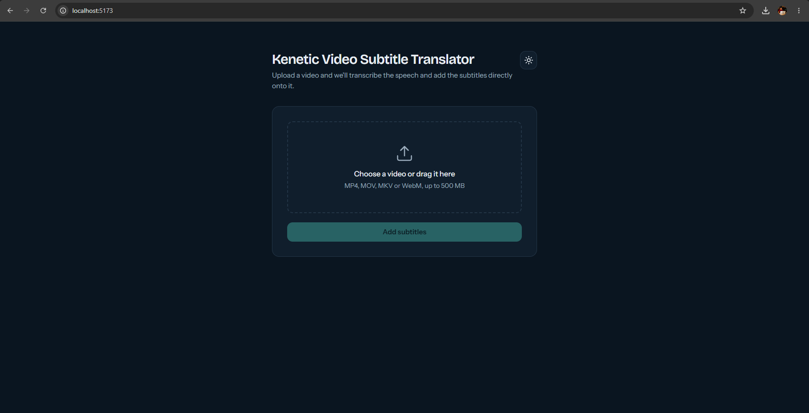
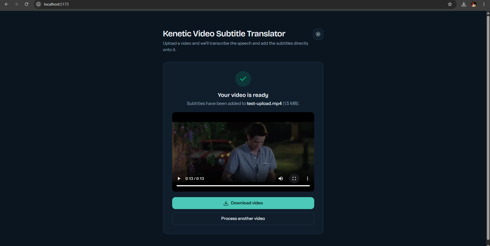
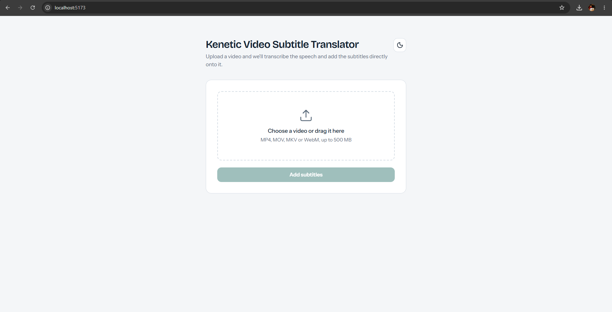

# Kenetic Video Subtitle Translator

Upload a video, and the app listens to the speech, translates it into English, and burns the English subtitles directly onto the video. When it's done, you can preview the result and download it.

- Supports MP4, MOV, MKV and WebM videos up to 500 MB
- Speech in other languages (for example Tagalog) is translated into English subtitles
- Speech-to-text runs locally with [faster-whisper](https://github.com/SYSTRAN/faster-whisper), so your videos are not sent to any third-party service
- Subtitles are burned into the video with FFmpeg
- Dark and light theme, with dark as the default

Speech in any language Whisper supports is translated into English subtitles. If the speech is already in English, the subtitles are simply the transcription. Translation quality depends on the language and the Whisper model size.

## Demo

Demonstrating on how to use the kenetic-video-subtitle-translator

https://github.com/user-attachments/assets/3a27ce5c-6124-45fe-b9e8-a0a03f3a3a47


| Upload | Result | Light mode |
| --- | --- | --- |
|  |  |  |

## Tech stack

| Part | Technology |
| --- | --- |
| Frontend | React, TypeScript, Vite, Tailwind CSS, TanStack Query, React Hook Form, Zod |
| Backend | Python 3.12, FastAPI, faster-whisper (`small` model, CPU), FFmpeg |
| Runtime | Docker and Docker Compose |

## Project structure

```
kenetic-video-subtitle-translator/
├── client/                 React frontend (Vite)
├── server/                 FastAPI backend
│   ├── index.py            API and video processing
│   ├── requirements.txt    Python dependencies
│   └── models/small/       Whisper model files (downloaded in step 2, not committed)
├── docs/                   Demo video and screenshots used in this README
├── .dockerignore
├── docker-compose.yml
├── Dockerfile-client
└── Dockerfile-server
```

## Code overview

The code is split so that each file has one job and is easy to find.

### Frontend (`client/src`)

```
src/
├── api/videos.ts            Calls the backend (fetch and error handling)
├── hooks/
│   ├── use-videos.ts        TanStack Query mutation that processes a video
│   └── use-theme.ts         Dark/light theme state, saved in localStorage
├── lib/video-schema.ts      Zod validation and small helpers (file size, output name)
├── pages/home.tsx           The upload page and its four states
├── components/
│   ├── theme-toggle.tsx     Sun/moon button
│   ├── page-ui.tsx          Shared class names and the page header
│   └── ui/                  Shared UI pieces such as the spinner
├── constants.ts             Allowed formats and the size limit
├── index.css                Theme colors (CSS variables) and Tailwind setup
└── main.tsx                 App entry: router and query client
```

A request flows through the layers in one direction:

1. `home.tsx` validates the chosen file with the Zod schema through React Hook Form.
2. On submit, it calls the `useProcessVideo` hook.
3. The hook calls `api.process`, which posts the file to `/api/process`.

The hook is a thin wrapper around the API call:

```ts
export function useProcessVideo() {
  return useMutation({
    mutationFn: (file: File) => api.process(file),
  })
}
```

The page reads `isIdle`, `isPending`, `isSuccess` and `isError` straight from the mutation, so there is no hand-written state machine to keep in sync.

### Backend (`server/index.py`)

`POST /api/process` runs these steps, each in its own small function or clearly marked block:

1. Check the file extension.
2. Save the upload in 1 MB chunks and stop at 500 MB.
3. Transcribe and translate the speech into English with faster-whisper (voice activity detection on).
4. Write the timestamped English subtitles to an `.srt` file (`generate_srt`).
5. Burn the subtitles into the video with FFmpeg (`burn_subtitles`).
6. Return the video and delete the temporary folder.

### Design decisions

- **Validation on both sides.** The Zod schema in the frontend mirrors the backend checks, so users get instant feedback, and the backend still enforces the rules.
- **Model loaded once, from disk.** The Whisper model loads at startup from `server/models/small`, so requests are not slowed down by loading it, and startup never depends on the network.
- **No CORS setup.** The Vite dev server proxies `/api` to the backend, so the browser only talks to one origin.
- **Temporary files are always cleaned up.** On success the folder is removed after the response is sent, and on every error path it is removed immediately.
- **Memory is released.** The frontend frees the in-memory result video when you start over or leave the page.

## Getting started

### Requirements

- [Docker](https://docs.docker.com/get-docker/) with Docker Compose
- About 5 GB of free disk space (images plus the Whisper model)
- At least 4 GB of memory available to Docker

### 1. Clone the repository

```bash
git clone <repo-url>
cd kenetic-video-subtitle-translator
```

### 2. Download the Whisper model (once)

The backend loads the model from `server/models/small`, so it never has to download anything when it starts. Run this one time from the project root:

```bash
docker compose run --rm --no-deps python-service-fastapi python -c "from huggingface_hub import snapshot_download; snapshot_download('Systran/faster-whisper-small', local_dir='/app/models/small')"
```

When it finishes, check that the files are there:

```bash
ls -lh server/models/small
```

You should see `model.bin` (several hundred MB), `config.json` and `tokenizer.json`.

If you get a permission error, add `--user root` right after `--no-deps` and run the command again. If the download keeps failing, download the files from [Systran/faster-whisper-small](https://huggingface.co/Systran/faster-whisper-small/tree/main) in your browser and place them in `server/models/small`.

### 3. Start the app

```bash
docker compose up --build -d
```

Check that the backend is ready:

```bash
docker logs -f fastapi_container
```

Wait until you see `Application startup complete.`

### 4. Open the app

| Service | URL |
| --- | --- |
| Web app | http://localhost:5173 |
| API | http://localhost:8000 |

### Stop the app

```bash
docker compose down
```

> If your Docker installation uses the older command, replace `docker compose` with `docker-compose`. Add `sudo` if your setup requires it.

## How to use

1. Open http://localhost:5173.
2. Choose a video or drag it onto the upload area.
3. Click **Add subtitles**.
4. Wait while the video is processed. Longer videos can take several minutes, so keep the page open.
5. When it's ready, preview the result and click **Download video**.

Tip: try a 10 to 20 second clip with clear speech first to check that everything works. Videos with no speech return the error "No subtitles could be generated."

Use the sun/moon button in the top corner to switch between dark and light mode. Your choice is remembered in the browser.

## API

The frontend talks to the backend through `/api`. In development, the Vite dev server forwards `/api` requests to the backend container, so no CORS setup is needed.

### `GET /`

Health check. Returns `{"status": "ok"}`.

### `POST /api/process`

Uploads a video and returns the video with English subtitles burned in.

- **Body:** `multipart/form-data` with a `file` field
- **Success:** `200` with the video as `video/mp4`

Example:

```bash
curl -X POST -F "file=@test-video.mp4" http://localhost:8000/api/process --output subtitled_video.mp4
```

Errors return JSON like `{"detail": "..."}`:

| Status | Meaning |
| --- | --- |
| 400 | Unsupported format, or the file is empty |
| 413 | File is larger than 500 MB |
| 422 | No speech was found, so no subtitles were created |
| 500 | Transcription, translation or video rendering failed |

Uploaded and generated files are stored in a temporary folder and deleted after each request.

## Configuration

| Setting | Where | Default |
| --- | --- | --- |
| `API_PROXY_TARGET` | `docker-compose.yml`, `react-service` | `http://python-service-fastapi:8000` |
| `HF_TOKEN`         | `docker-compose.yml` | `replacewithyourhftoken` |
| Max upload size | `MAX_FILE_SIZE` in `server/index.py` and `MAX_SIZE_MB` in `client/src/constants.ts` | 500 MB |
| Allowed formats | `ALLOWED_EXTENSIONS` in `server/index.py` and `client/src/constants.ts` | `.mp4 .mov .mkv .webm` |
| Whisper model | `MODEL_DIR` in `server/index.py` | `server/models/small` |

If you change the upload limit or formats, change them in both the backend and the frontend so they match.

### Using a different Whisper model

Smaller models are faster but less accurate, and larger ones are more accurate but slower. Translation quality for languages such as Tagalog generally improves with a larger model. To switch, download another model into its own folder, for example:

```bash
docker compose run --rm --no-deps python-service-fastapi python -c "from huggingface_hub import snapshot_download; snapshot_download('Systran/faster-whisper-base', local_dir='/app/models/base')"
```

Then point `MODEL_DIR` in `server/index.py` at `models/base` and restart the backend.

## Running without Docker

You need Node.js, Python 3.12 and FFmpeg installed on your machine.

**Backend**

```bash
cd server
pip install -r requirements.txt
uvicorn index:app --reload --port 8000
```

The Whisper model must be in `server/models/small` (see step 2 above).

**Frontend**

```bash
cd client
npm install
npm run dev
```

Outside Docker, the dev server forwards `/api` to `http://localhost:8000` by default.

## Troubleshooting

**The page loads but the upload never finishes.** Processing runs on the CPU and the page does not show detailed progress. Check that the backend is working with `docker logs -f fastapi_container` and `docker stats`. High CPU usage means it is still working. Try a shorter video, or use a smaller Whisper model.

**The backend container keeps restarting or the API does not respond.** Check `docker logs fastapi_container`. If it says the Whisper model was not found, repeat step 2 and make sure `server/models/small/model.bin` exists.

**`Video processing failed.` with `open() got an unexpected keyword argument 'metadata_errors'` in the logs.** The installed `av` package is too new for `faster-whisper`. Make sure `server/requirements.txt` contains `av<19`, then rebuild with `docker compose up --build -d`.

**`502 Bad Gateway` on `/api/process`.** The frontend cannot reach the backend. Check that `fastapi_container` is running and that `API_PROXY_TARGET` is set to `http://python-service-fastapi:8000` for the `react-service` in `docker-compose.yml`. After changing it, run `docker compose up -d --force-recreate react-service`.

**The container is killed during processing.** Docker probably ran out of memory. On Windows with WSL 2, increase the limit in `C:\Users\<you>\.wslconfig`:

```ini
[wsl2]
memory=8GB
```

Then run `wsl --shutdown` and restart Docker.

**Port already in use.** Another program is using port 5173 or 8000. Stop it, or change the left side of the port mapping in `docker-compose.yml` (for example `"5174:5173"`).

**Free up disk space.** Run `docker compose down`, then `docker builder prune -a` and `docker system prune -a`. Do not add `--volumes` unless you want to delete named volumes too.

## Notes

- Processing runs on the CPU. Expect a video of a few minutes to take several minutes to process.
- The model files are large and should not be committed. Add `server/models/` to `.gitignore`.
- There is no authentication or rate limiting, so this setup is meant for local use and not for exposing to the internet as is.
